# ShopEasy — E-commerce App: Monolithic vs Microservices

An e-commerce application built twice in **Python (Flask)** to compare two architectures:

| | Monolithic (`/monolithic`) | Microservices (`/microservices`) |
|---|---|---|
| Codebase | One Flask app | Separate service per business capability |
| Database | One shared SQLite DB | Each service owns its own DB |
| Deployment | One process, one port (5000) | Each service runs and scales on its own port |
| Communication | Direct function calls | HTTP/REST calls between services |

## Features
- View all products and product details
- Search products (by name, description, category) and filter by category
- Shopping cart (add, update quantity, remove)
- Checkout with a **mock payment gateway** (test mode, no real money)
  - Any 16-digit card succeeds; a card ending in `0000` is declined (to demo failure handling)
- Order confirmation and order history

## 1. Monolithic application

All modules (catalog, search, cart, orders and payment) are in a single `app.py`
and share one database (`shop.db`, created automatically with sample products).

```
monolithic/
├── app.py            # all routes + business logic
├── requirements.txt
├── static/style.css
└── templates/        # HTML pages
```

### Run it
```bash
cd monolithic
pip install -r requirements.txt
python app.py
```
Open http://localhost:5000

Test card: `4242 4242 4242 4242`, expiry `12/28`, CVV `123`

### Screenshots
| Products | Search | Product detail |
|---|---|---|
| 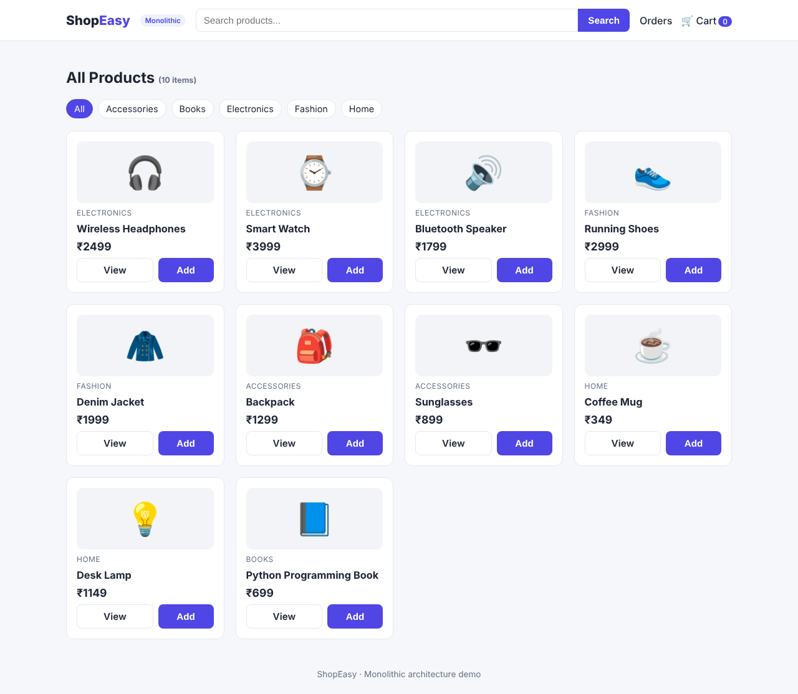 | 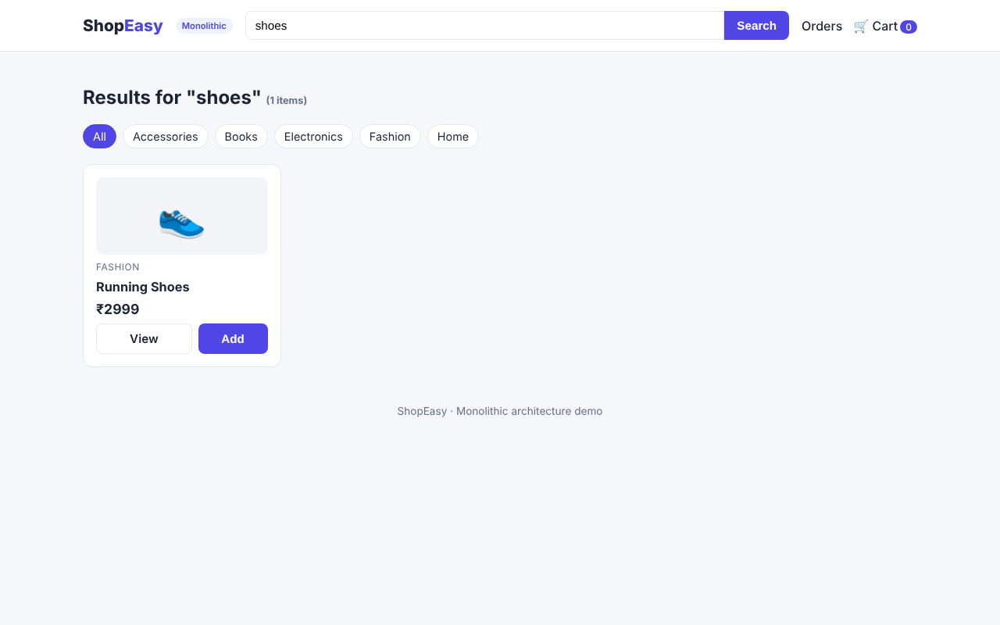 | 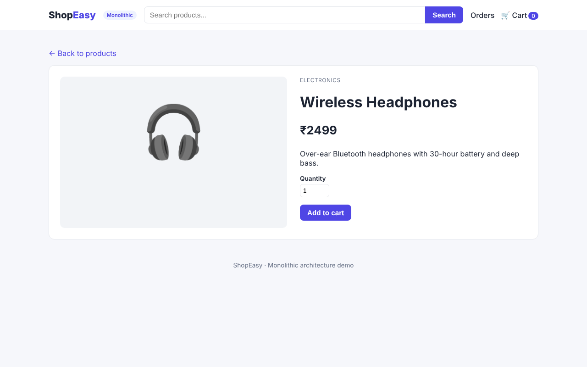 |

| Cart | Checkout & payment | Payment success | Orders |
|---|---|---|---|
| 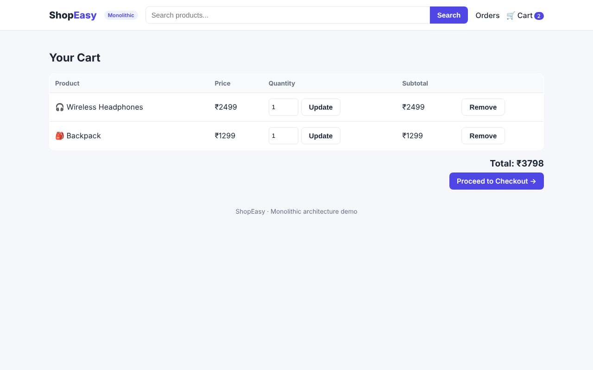 | 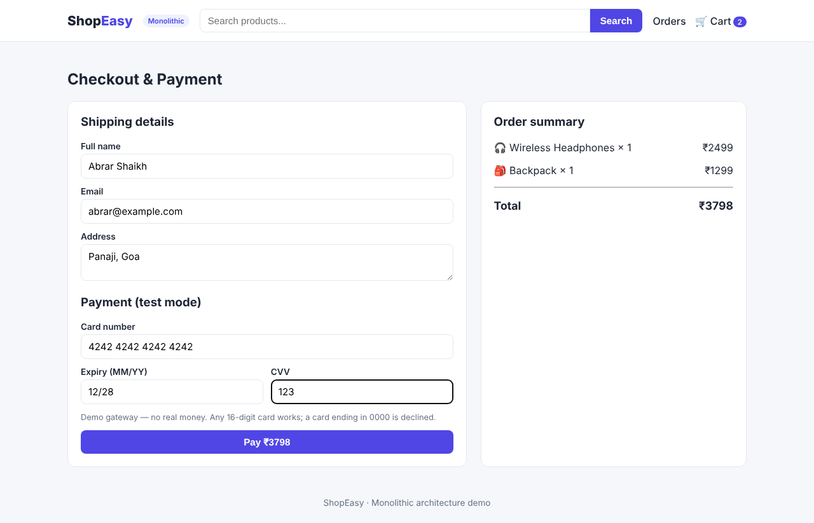 | 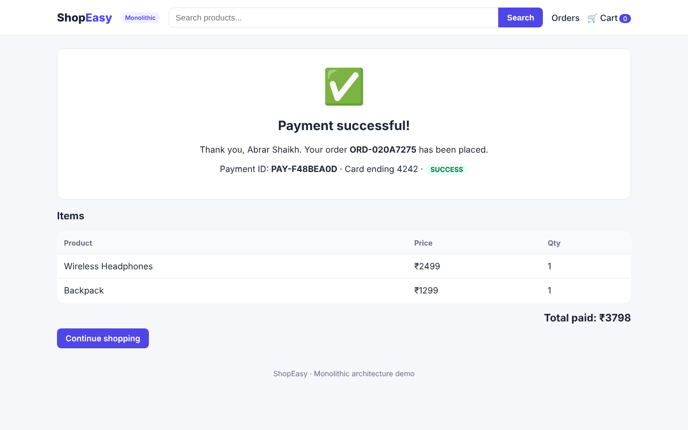 | 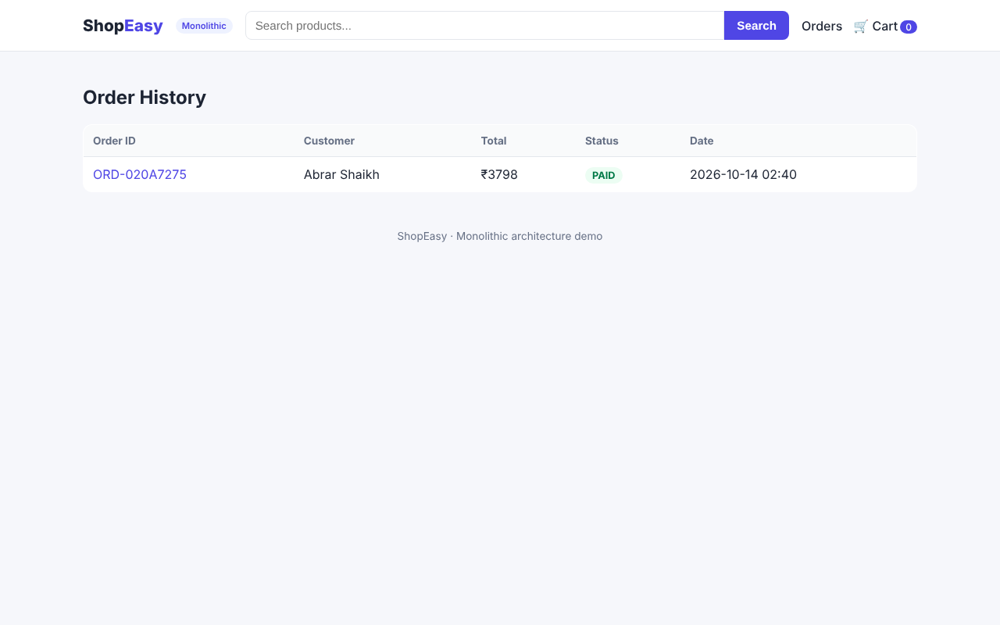 |

## 2. Microservices application

The same features, split into **independent services**. Each service has its own code,
its own database and its own port, and they talk to each other only through REST (HTTP/JSON) calls.

```
                       Browser
                          │
                 ┌────────▼────────┐
                 │ frontend :5000  │  (pages only, no database)
                 └──┬────┬────┬───┬┘
         ┌──────────┘    │    │   └───────────────┐
┌────────▼────────┐ ┌────▼────────┐ ┌─────────────▼────┐
│ product-service │ │ cart-service│ │  order-service   │
│     :5001       │◄┤    :5002    │◄┤      :5003       │
│  products.db    │ │   cart.db   │ │    orders.db     │
└─────────────────┘ └─────────────┘ └────────┬─────────┘
                                    ┌────────▼─────────┐
                                    │ payment-service  │
                                    │      :5004       │
                                    │   payments.db    │
                                    └──────────────────┘
```

| Service | Port | Responsibility | API endpoints |
|---|---|---|---|
| product-service | 5001 | Product catalogue and search | `GET /products?q=&category=`, `GET /products/<id>`, `GET /categories` |
| cart-service | 5002 | Shopping carts (calls product-service for prices) | `GET /cart/<id>`, `POST /cart/<id>/items`, `PUT`/`DELETE /cart/<id>/items/<pid>`, `DELETE /cart/<id>` |
| order-service | 5003 | Places orders (calls cart-service and payment-service) | `POST /orders`, `GET /orders`, `GET /orders/<id>` |
| payment-service | 5004 | Mock payment gateway | `POST /payments`, `GET /payments/<order_id>` |
| frontend | 5000 | Web pages; calls the services | `/`, `/product/<id>`, `/cart`, `/checkout`, `/orders`, `/services` |

Every service also has `GET /health`. The **Services** page in the frontend shows whether each one is up.

**Placing an order:** frontend → `order-service` → gets the cart from `cart-service` →
charges the card through `payment-service` → marks the order PAID → asks `cart-service` to clear the cart.

### Run it (all services with one command)
```bash
cd microservices
pip install flask requests
python run_all.py
```
Open http://localhost:5000 (press Ctrl + C to stop all services).

You can also start each service in its own terminal with `python app.py` inside its folder,
or with Docker: `docker compose up`.

### Screenshots
| Products | Search | Product detail |
|---|---|---|
| 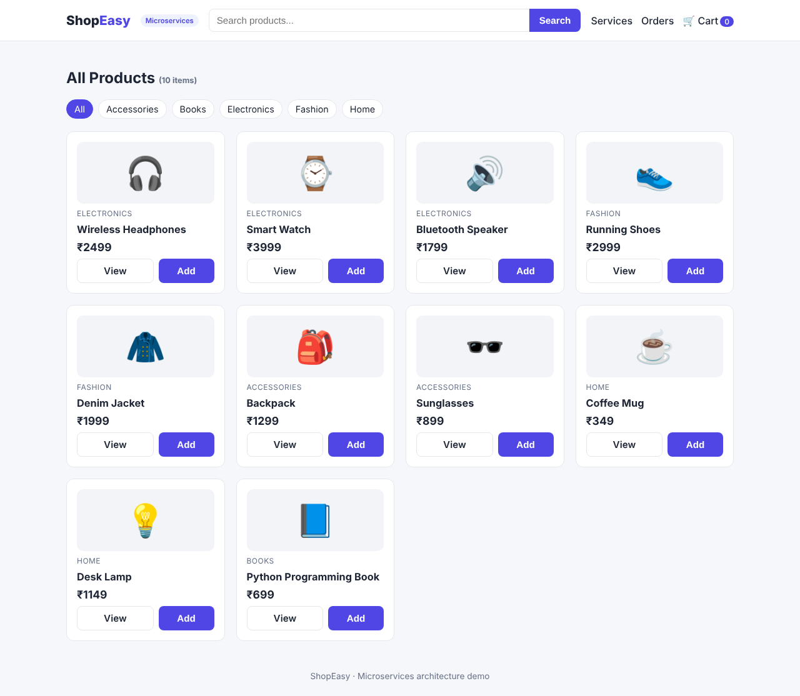 | 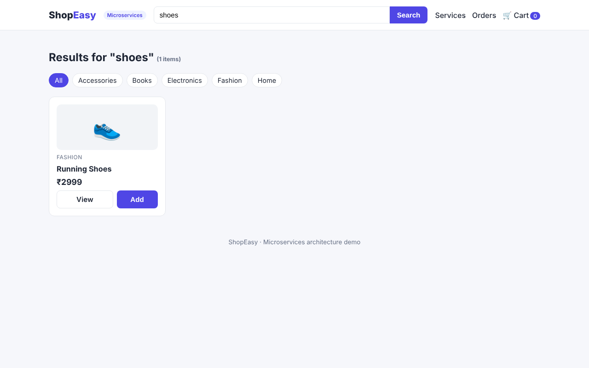 | 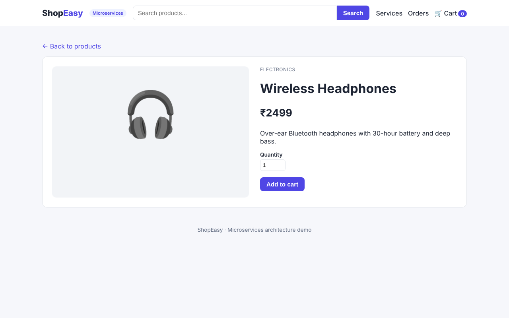 |

| Cart | Checkout & payment | Payment success | Orders |
|---|---|---|---|
| 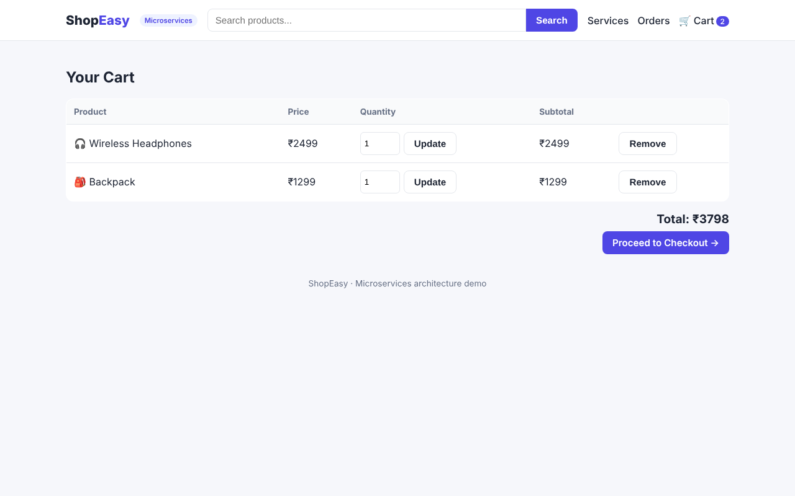 | 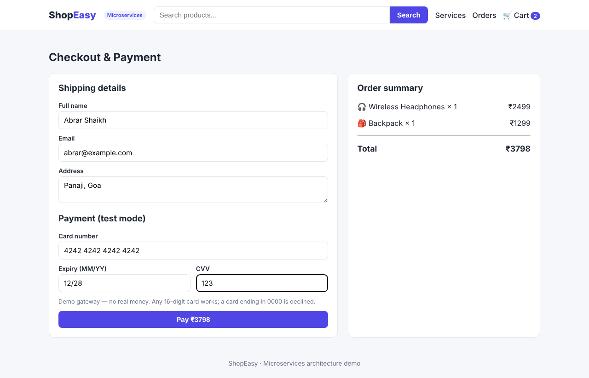 | 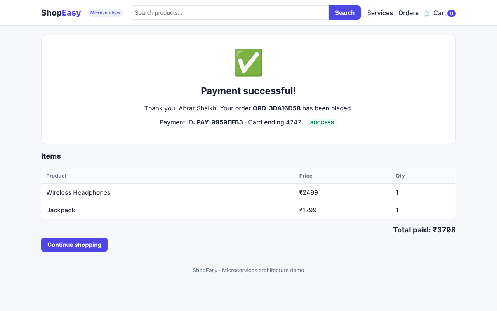 | 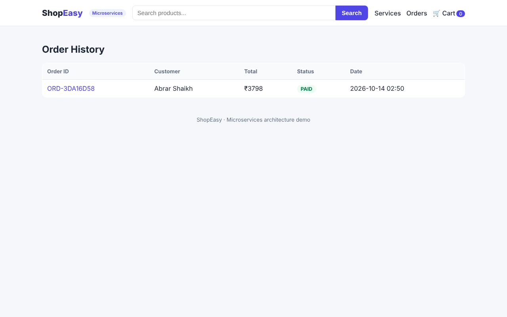 |

| Services status |
|---|
| 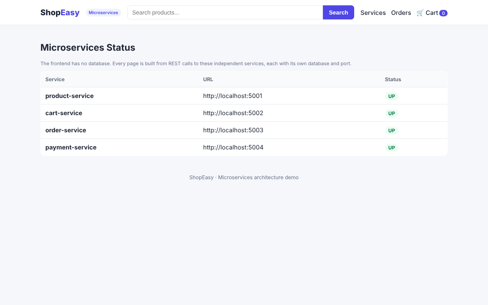 |

## Monolithic vs Microservices: summary

| | Monolithic | Microservices |
|---|---|---|
| Development | Simple to build and debug | More setup; services must agree on APIs |
| Deployment | Redeploy the whole app for any change | Deploy and update each service separately |
| Scaling | Scale the whole app together | Scale only the busy service (e.g. product search) |
| Failure | One bug can bring the whole app down | If one service fails, the others keep running |
| Data | One shared database | Each service owns its data |
| Best for | Small apps and small teams | Large apps and teams working in parallel |
