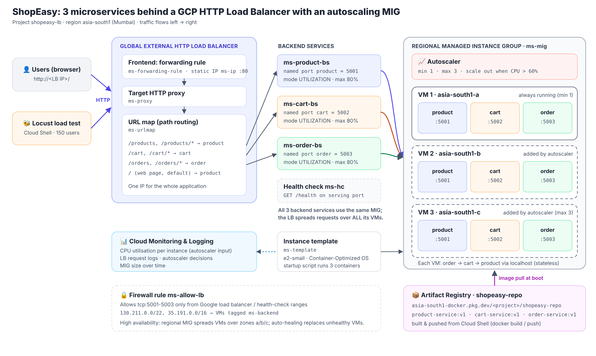

# ShopEasy: 3 microservices behind an HTTP Load Balancer with autoscaling (GCP)



| Requirement | How it is done |
|---|---|
| Containerization | 3 Docker images (`product-service`, `cart-service`, `order-service`) built and pushed to **Artifact Registry** (`shopeasy-repo`) |
| Traffic routing | One **global external HTTP Load Balancer** on a static IP. Its **URL map** routes `/products*`, `/cart*` and `/orders*` to 3 **backend services** |
| Auto-scaling pool | **Regional Managed Instance Group** `ms-mig` (zones a/b/c). Every VM runs all 3 containers |
| Scaling rules | **min 1, max 3**, scale out when **CPU > 60%** (set in `config.sh`) |
| Load test | **Locust**, run from Cloud Shell, with 150 simulated shoppers |
| High availability | VMs spread over 3 zones; auto-healing health check; the services are stateless, so any VM can serve any request |

## The 3 microservices

| Service | Port | Endpoints | Notes |
|---|---|---|---|
| product-service | 5001 | `GET /` (web page), `GET /products?q=`, `GET /products/<id>`, `GET /health` | Catalogue and search |
| cart-service | 5002 | `POST /cart/quote`, `GET /cart`, `GET /health` | Prices the cart (calls product-service), GST, shipping, discount engine |
| order-service | 5003 | `POST /orders`, `GET /orders`, `GET /health` | Calls cart-service, runs the mock payment, signs the payment (CPU-heavy) |

Every response includes `served_by`, the name of the VM that handled it, so you can see the load balancer spreading traffic.

---

## Step-by-step (all commands run in Google Cloud Shell)

### Step 0: Open Cloud Shell and get the code
```bash
gcloud config set project shopeasy-lb
git clone -b lb-autoscaling https://github.com/MrHacker628/Monolithic.git ms-lb
cd ms-lb/cloud-lb
```

### Step 1: Build the images and push them to the registry (about 3 min)
```bash
bash 1-build-and-push.sh
```
📸 The final table listing the 3 images, plus the **Artifact Registry** page (links below).

### Step 2: Create the instance template, MIG and autoscaling (about 1 min, then 2 min boot)
```bash
bash 2-create-mig.sh
```
📸 The **Instance groups** page showing `ms-mig` with autoscaling **min 1 / max 3 / CPU 60%**.

### Step 3: Create the HTTP Load Balancer (about 1 min, then 5–10 min to go live)
```bash
bash 3-create-load-balancer.sh
bash status.sh
```
Wait until `status.sh` shows **HEALTHY** for all 3 backend services, then open `http://<LB IP>`.
📸 The shop page, then **Run 30 × 3 requests** (load-balancer test), then **Load balancing** → `ms-urlmap` (frontend, routing rules, backends).

### Step 4: Load test and watch it scale (about 15–20 min)
**Tab 1** (watcher; leave it running):
```bash
bash watch-scaling.sh
```
**Tab 2** (open a new tab with the **+** next to "Terminal"):
```bash
cd ~/ms-lb/cloud-lb
bash 4-load-test.sh
```
Click **Web preview** (the eye icon) → **Preview on port 8080**, set **Users 150**, **Ramp up 5**, then **Start**.
Leave it running for about 10 minutes. CPU climbs above 60% and the MIG grows **1 → 2 → 3**.
📸 Locust **Charts** and **Statistics** tabs, the watcher output, the MIG **Monitoring** tab (CPU and instance count),
the **VM instances** page with 3 `ms-mig-…` VMs, and the autoscaler logs.

Then click **Stop** in Locust. Within about 10 minutes the group scales back down to 1 (📸 optional).

### Step 5: Delete everything (so credits are not used)
```bash
bash cleanup.sh
```

---

## Console pages for screenshots (project `shopeasy-lb`)

| What to show | Link |
|---|---|
| Container images in the registry | https://console.cloud.google.com/artifacts/docker/shopeasy-lb/asia-south1/shopeasy-repo?project=shopeasy-lb |
| Instance template | https://console.cloud.google.com/compute/instanceTemplates/list?project=shopeasy-lb |
| Instance groups (autoscaling column) | https://console.cloud.google.com/compute/instanceGroups/list?project=shopeasy-lb |
| MIG details → **Monitoring** tab (CPU and instance graphs) | https://console.cloud.google.com/compute/instanceGroups/details/asia-south1/ms-mig?project=shopeasy-lb |
| VM instances (1 → 3 VMs) | https://console.cloud.google.com/compute/instances?project=shopeasy-lb |
| Load balancers list | https://console.cloud.google.com/net-services/loadbalancing/list/loadBalancers?project=shopeasy-lb |
| Load balancer details (frontend, routing rules, backends) and **Monitoring** tab | https://console.cloud.google.com/net-services/loadbalancing/details/http/ms-urlmap?project=shopeasy-lb |
| Backend services | https://console.cloud.google.com/net-services/loadbalancing/list/backends?project=shopeasy-lb |
| Health checks | https://console.cloud.google.com/compute/healthChecks?project=shopeasy-lb |
| Firewall rules | https://console.cloud.google.com/net-security/firewall-manager/firewall-policies/list?project=shopeasy-lb |
| Logs Explorer (autoscaler / LB logs) | https://console.cloud.google.com/logs/query?project=shopeasy-lb |
| Metrics Explorer (CPU utilization graph) | https://console.cloud.google.com/monitoring/metrics-explorer?project=shopeasy-lb |

**Logs Explorer queries** (paste into the query box, then click **Run query**):
- Autoscaler decisions (scale out/in): `resource.type="autoscaler"`
- Instance group resizing: `resource.type="gce_instance_group_manager"`
- Requests through the load balancer: `resource.type="http_load_balancer"`

**Metrics Explorer:** choose metric **VM Instance → Instance → CPU utilization**, filter `instance_name =~ ms-mig.*`, aggregation **none**.
You'll see one line per VM, crossing 60% and new lines appearing as VMs are added.

## Files
| File | Purpose |
|---|---|
| `config.sh` | Region, names, **MIN/MAX replicas, CPU target** |
| `1-build-and-push.sh` | Artifact Registry repo, `docker build` and `docker push` ×3 |
| `2-create-mig.sh` | IAM for image pull, startup script, instance template, firewall, health checks, regional MIG, named ports, autoscaler |
| `3-create-load-balancer.sh` | Static IP, 3 backend services, URL map, HTTP proxy, forwarding rule |
| `4-load-test.sh`, `loadtest/locustfile.py` | Locust load test (web UI or `headless`) |
| `watch-scaling.sh` | Logs the instance count every 15 s to `scaling-log.txt` |
| `status.sh` | Instances, autoscaler and backend health at a glance |
| `cleanup.sh` | Deletes everything |
| `docs/architecture.png` | Architecture diagram |
